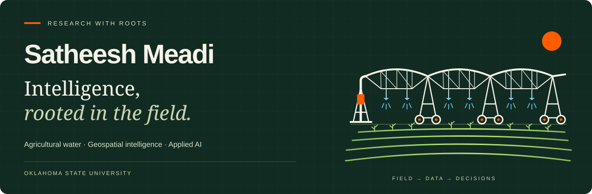
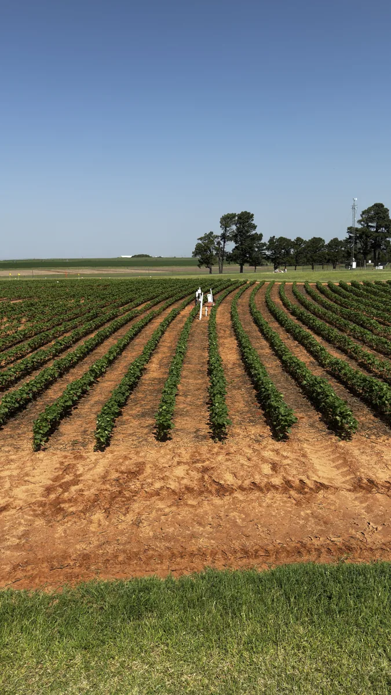
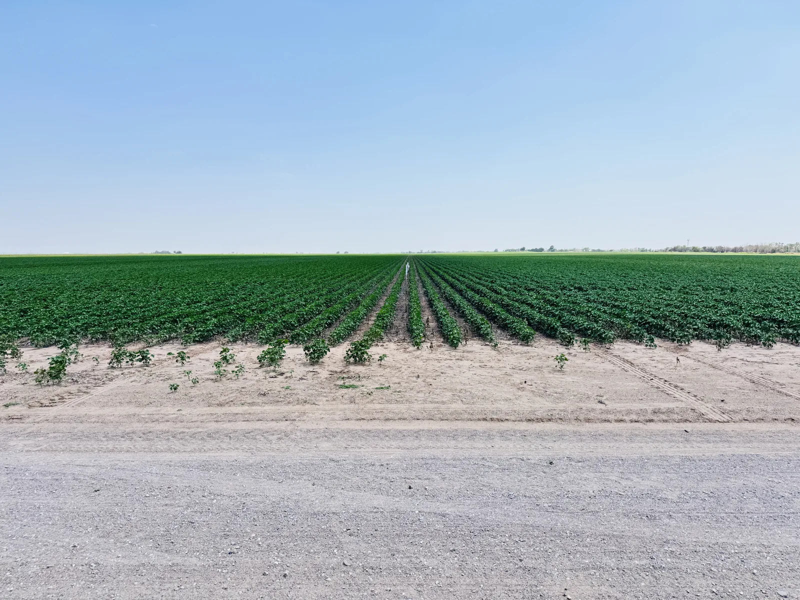
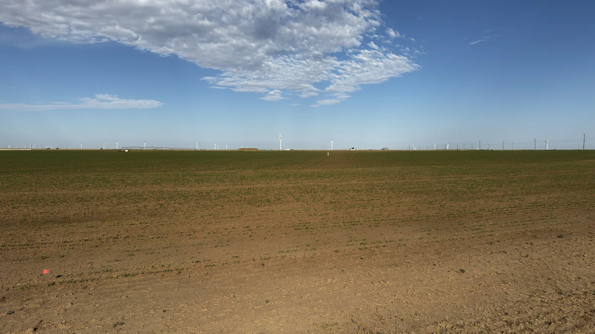

  

  <strong>PhD Researcher · Data Scientist · Field Practitioner</strong> 
  Biosystems &amp; Agricultural Engineering · Oklahoma State University 
  Irrigation Research Laboratory · Stillwater, Oklahoma

  <a href="https://satheesh-meadi.github.io/Satheesh-Meadi/"><strong>Explore my portfolio ↗</strong></a>
  &nbsp; · &nbsp; <a href="assets/Satheesh-Meadi-CV.pdf">Read my CV</a>
  &nbsp; · &nbsp; <a href="https://www.linkedin.com/in/satheesh-meadi/">LinkedIn</a>
  &nbsp; · &nbsp; <a href="mailto:satheesh.meadi@okstate.edu">Email</a>

---

## A computer scientist. Agriculture at heart.

<table>
  <tr>
    <td width="32%" align="center" valign="middle">
      
       Based in Stillwater, Oklahoma
    </td>
    <td width="68%" valign="middle">
      
I’m Satheesh. I connect agricultural science and applied AI to understand crop water needs and turn field data into better decisions.

      
My path began in computer science, continued through a master’s in data science at UMBC, and brought me to agricultural research at Oklahoma State.

      
I enjoy the whole process: wiring a sensor, questioning a measurement, building a model, and explaining what it means to someone who can use it.

      
<strong>Currently exploring:</strong> canopy temperature, atmospheric humidity, irrigation estimation, and the data systems that support this research.

    </td>
  </tr>
</table>

## What I’m working on

| 🌱 Canopy temperature | ☁️ Atmosphere & water | 🛰️ Geospatial intelligence |
| :--- | :--- | :--- |
| Estimating height-adjusted canopy temperature from fixed sensors and weather measurements. | Investigating how relative humidity affects canopy-temperature-based irrigation decisions. | Combining OpenET, vegetation indices, precipitation, and reference ET to estimate irrigation requirements. |
| **OLS · Random Forest · LightGBM** | **Weather data · Irrigation scheduling** | **Google Earth Engine · OpenET · Python** |

[Explore the questions behind my research →](https://satheesh-meadi.github.io/Satheesh-Meadi/#research)

## Good science gets its boots dusty.

Installing sensors, checking measurements, and working with growers keep my research connected to the field. Here is a documented part of my **June–August 2026** season.

<table>
  <tr>
    <td width="33%" align="center"><h3>11</h3>Fieldwork dates</td>
    <td width="34%" align="center"><h3>36</h3>Individual site visits</td>
    <td width="33%" align="center"><h3>3</h3>Oklahoma field regions</td>
  </tr>
  <tr>
    <td align="center"> <strong>Caddo</strong> Cotton canopy monitoring · June 30</td>
    <td align="center"> <strong>Altus</strong> Cotton field monitoring · June 30</td>
    <td align="center"> <strong>Panhandle</strong> Sorghum fieldwork · July 10</td>
  </tr>
</table>

Counts reflect supplied field notes naming me among the visitors. One travel date can include several site visits; this is a portion of my fieldwork history.

**[Open the interactive field journal →](https://satheesh-meadi.github.io/Satheesh-Meadi/#fieldwork)**

## Beyond the field: selected software

| Project | What I built | Tools & methods |
| :--- | :--- | :--- |
| **[Medi-Text Summarizer](https://github.com/SATHEESH-MEADI/Medical-Text-Analysis-System)** | Medical-text summarization, entity recognition, and multilingual question answering. | Transformers · NLP · Streamlit |
| **[Financial Risk Pipeline](https://github.com/SATHEESH-MEADI/Real_Time_Financial_Risk_Dashboard)** | Market-data ingestion, CAPM analytics, and portfolio dashboards. | Airflow · Snowflake · PostgreSQL |
| **[Dribble, Predict, Win](https://github.com/SATHEESH-MEADI/NBA-Game-Forecast)** | Basketball outcome forecasting with data pipelines and model drift monitoring. | PySpark · Machine learning |

## My working toolkit

**Research & geospatial** &nbsp; Python · Google Earth Engine · OpenET · Environmental data 
**Models & language** &nbsp; Machine learning · LightGBM · Hugging Face · NLP 
**Data & systems** &nbsp; SQL · PySpark · Airflow · PostgreSQL · Snowflake · Cloud platforms

## The path so far

| When | Where | Focus |
| :--- | :--- | :--- |
| **2026–present** | **Oklahoma State University** | PhD in Biosystems & Agricultural Engineering · Graduate Research Assistant |
| **2023–2025** | **University of Maryland, Baltimore County** | MS in Data Science · Graduate Assistant · Math Tutor |
| **2019–2023** | **Mohan Babu University** | BTech in Computer Science |

Along the way: **AI Research Fellow at Handshake MOVE** (August–December 2025) and **Graduate Engineer Intern at LTIMindtree** (January–August 2023).

## Research, shared.

- **2026 · IEEE DCAS** — [Canopy Temperature Sensor Data Optimization for Irrigation Scheduling](https://doi.org/10.1109/DCAS69364.2026.11545108)
- **2023 · Journal of Survey in Fisheries Sciences** — [Stock Price Prediction by Normalizing LSTM and GRU Models](https://www.researchgate.net/publication/383870856_View_of_Stock_Price_Prediction_by_Normalizing_LSTM_and_GRU_Models)
- **2022 · Journal of Pharmaceutical Negative Results** — [Extreme Learning Mechanism for Classification & Prediction of Soil Fertility Index](https://www.pnrjournal.com/index.php/home/article/view/1622)

[Publications and conference contributions →](https://satheesh-meadi.github.io/Satheesh-Meadi/#publications)

---

  <strong>Have a question worth exploring?</strong> 
  I’m interested in agricultural water, useful AI, and research that reaches beyond the screen.

  <a href="mailto:satheesh.meadi@okstate.edu">Let’s connect</a>
  &nbsp; · &nbsp; <a href="https://satheesh-meadi.github.io/Satheesh-Meadi/">Visit my portfolio</a>
  &nbsp; · &nbsp; <a href="https://www.linkedin.com/in/satheesh-meadi/">Find me on LinkedIn</a>

